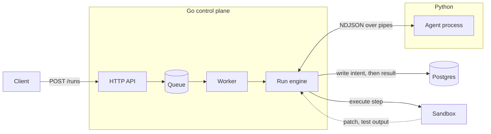
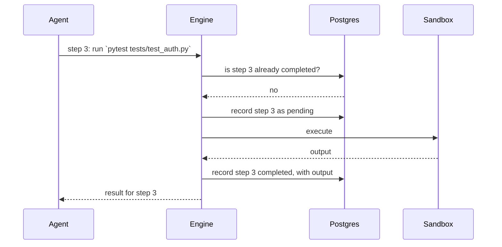
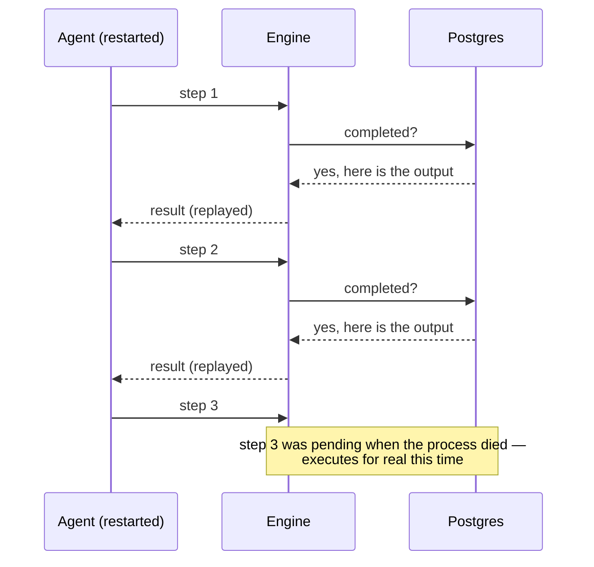
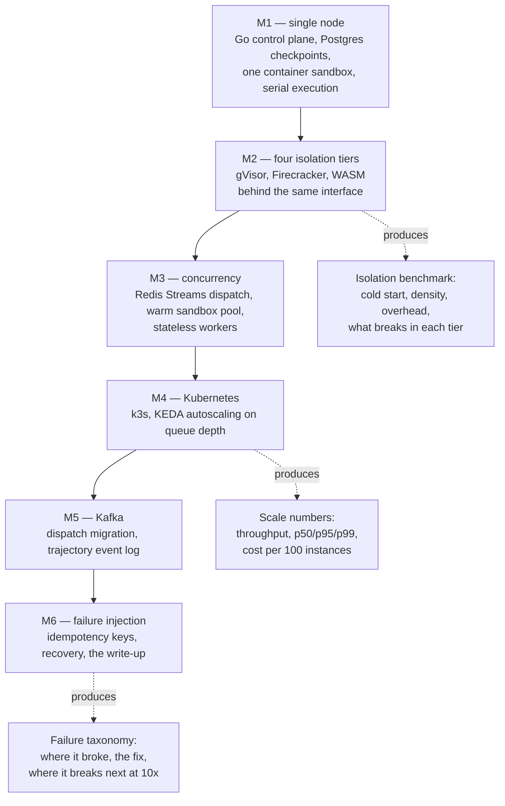

# How bulkhead works

## The shape of one run

A run is one SWE-bench instance: an issue, a repository at a known commit, and a set of tests
that must go from failing to passing.

The control plane owns everything durable. The agent owns nothing — it asks for a step and
blocks until the control plane answers. That inversion is what the whole design rests on.

## Why the agent can't execute its own steps

The obvious design is: the agent reads files, edits files, runs tests, and reports back. It
cannot be checkpointed, because the only record of what happened lives in the agent's own memory
and dies with the process.

So bulkhead inverts it. The agent is a pure step generator; the control plane decides whether a
requested step executes or is answered from a checkpoint.

Resume needs no separate code path. The agent is restarted from scratch and asks for the same
steps in the same order; the completed ones are answered from Postgres without executing, so it
walks back to where it died and carries on.

## The write ordering, and the one gap it leaves

Durability rests on writing intent before doing the work:

1. Record the step as `pending`
2. Execute it
3. Record the output and mark it `completed`

A process that dies between 1 and 2 leaves a `pending` row and no side effect. A process that
dies between 2 and 3 leaves a `pending` row and a side effect that already happened — and from
the outside those two are indistinguishable.

So on resume, a `pending` step is executed again. That is **at-least-once**, and it is the one
honest gap in Milestone 1. The acceptance test encodes it precisely: every step whose result was
already durable must be replayed rather than re-executed, and at most one step — the one in
flight when the process died — may repeat.

Closing that gap is Milestone 6: pass an idempotency key with every step so the executor can
recognize a retry of work it already did. The acceptance test is written so that milestone
tightens the bound rather than rewriting the test.

## What each milestone adds

Every component exists because a specific gap demanded it. Nothing here is decoration.

## On measuring cost

Only one published number depends on which model the agent uses: **resolve rate**. Throughput,
latency percentiles, cold-start times, sandbox density, and the failure taxonomy are properties
of the harness — they are identical whether the patches are good or garbage.

That makes the development loop cheap. The acceptance test runs against a deterministic fixture
agent and costs nothing. Harness development and the isolation benchmark can run against the
cheapest available model. A single expensive pass at the end produces the one number that
warrants it.
